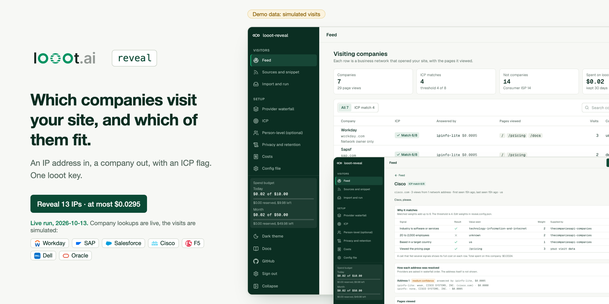
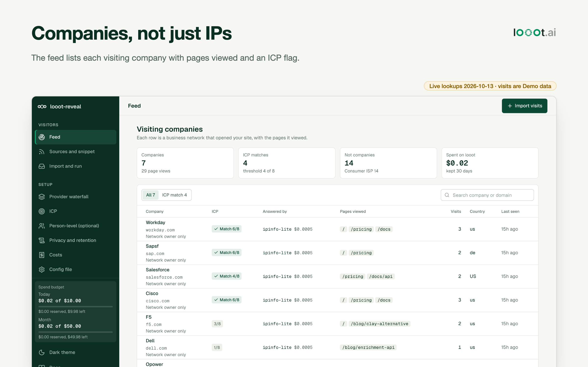
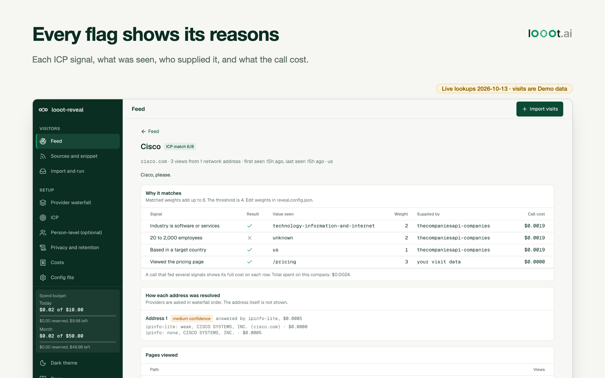
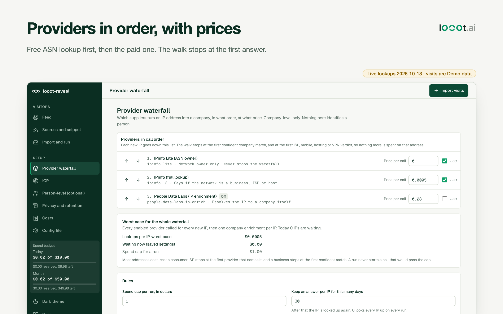
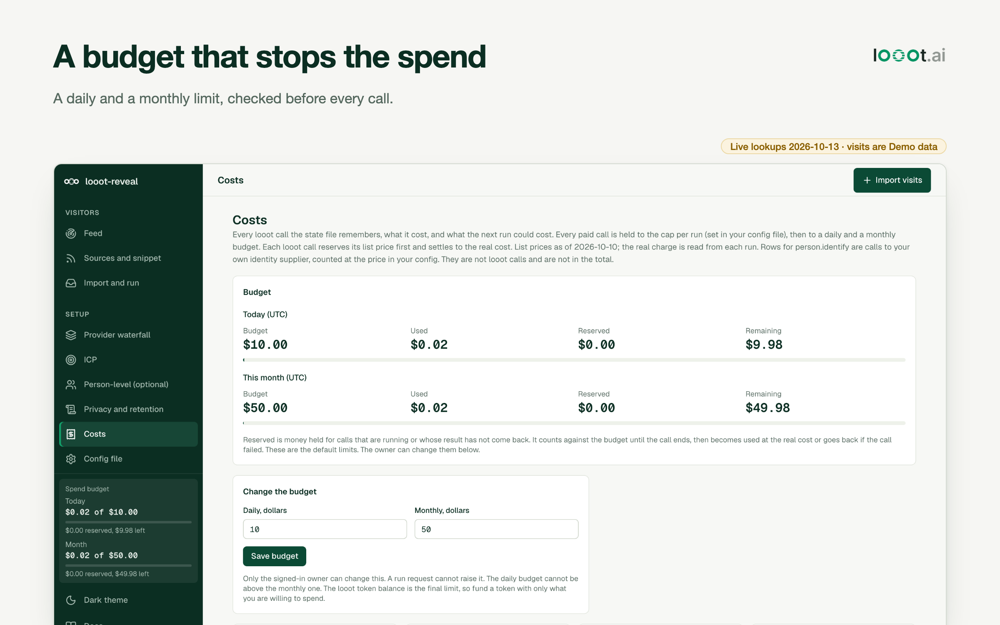
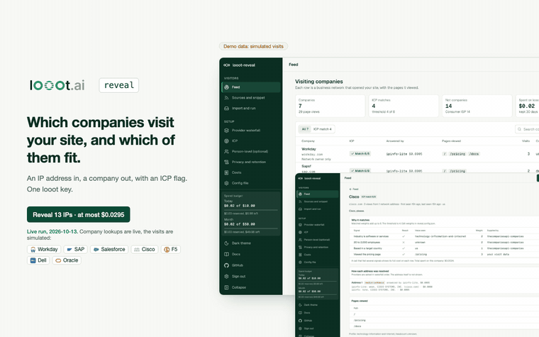
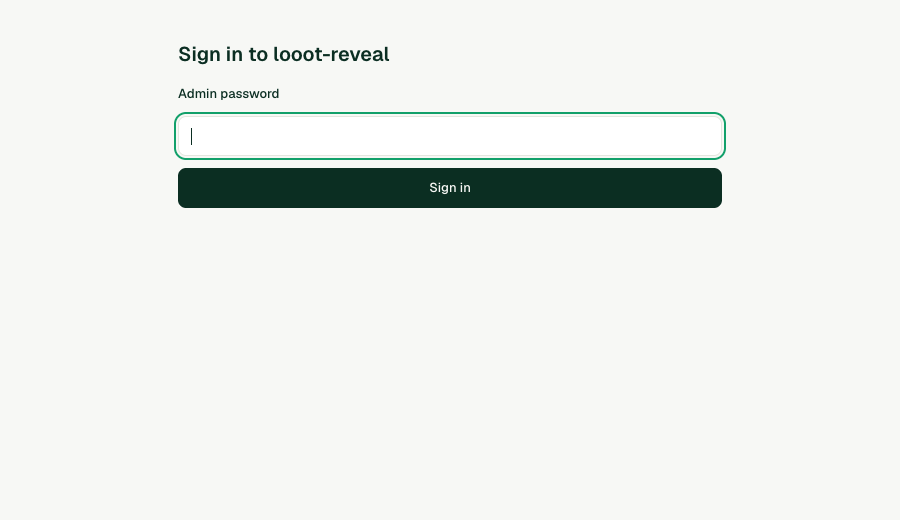
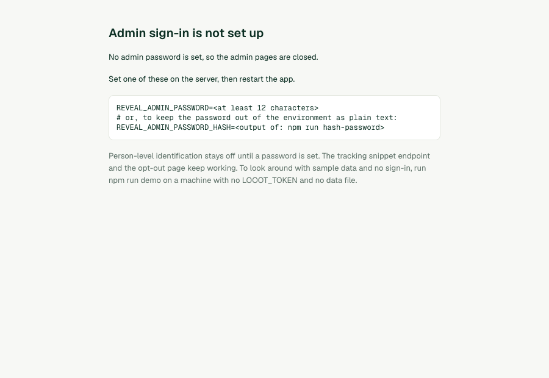
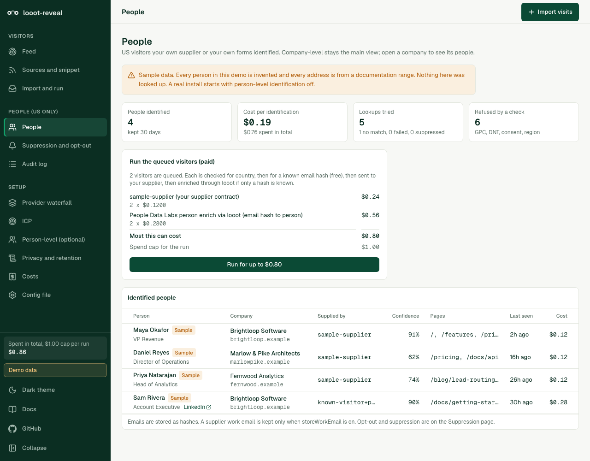

Logos and names belong to their owners. Company lookups are from a live run on 2026-10-13, the visits are simulated (Demo data). No affiliation.

# looot-reveal

[](LICENSE) [](https://github.com/loootai/looot-reveal/releases) [](https://docs.looot.ai)

An open-source alternative to [RB2B](https://www.rb2b.com/pricing) and Clearbit Reveal: see which companies visit your website. RB2B starts at $0 for 150 identifications a month and $79 a month for 300 (public pricing page, read 2026-10-10). Clearbit Reveal now sells inside HubSpot Breeze Intelligence on a credit plan, with a third-party estimate of about $45 a month on top of a HubSpot seat (not a vendor figure, read 2026-10-10). This repo runs on one looot key and you pay list price per lookup, about $0.0005 to find the company behind an IP.

It reads an access log, a CSV of IPs, or visits from a small tracking snippet. It looks each IP up through looot's IP intelligence provider, drops ISPs, hosting and VPNs, enriches the company that is left, and shows a feed of visiting companies with the pages they viewed and an ICP match flag.

> **Security notice.** Versions 0.2.0 and older had no admin sign-in. Anyone who could reach a deployed instance could read visitors, change settings, start paid looot runs and edit the suppression list. If you run v0.2.0 or older on a reachable host, upgrade to v0.2.1 and set `REVEAL_ADMIN_PASSWORD`. See [Securing a deployment](#securing-a-deployment).

<table>
<tr>
<td width="50%"></td>
<td width="50%"></td>
</tr>
<tr>
<td></td>
<td></td>
</tr>
</table>



The same walkthrough as MP4: [docs/media/demo.mp4](docs/media/demo.mp4).

## Live run, 2026-10-13

I looked up 13 real public IP addresses with one looot token and the default waterfall. The visits are made up (Demo data): 29 page views written into a log file, so no real visitor is involved. The lookups are live.

- 8 addresses belong to companies that run their own network: Cisco, Oracle, Salesforce, SAP, Dell, Adobe, Workday and F5. I took them from public DNS (the apex and mail hosts of each domain).
- 5 addresses are the web servers of Clay, Apollo.io, ZoomInfo, Apify and HubSpot, from `dig`.

| | |
|---|---|
| Calls | 27 (20 IP lookups, 7 company enrichments) |
| Charged | $0.0217 (the quote said at most $0.0295) |
| Companies found | 7, of which 4 match the default ICP |
| Dropped | 6 addresses: 3 Cloudflare, 3 Amazon |

What was good and what was not:

- The five competitor web servers sit behind Cloudflare or Amazon, so looot answered with the network owner and the app dropped them. That is the right result: those IPs say nothing about who visits. Most startups look like this from the outside, so a reveal tool finds mostly companies with their own address space, plus office traffic.
- Every match is "medium" confidence. Only the free ASN lookup named the company, and the paid IPinfo lookup agreed or added nothing.
- Two company names from the enrichment are wrong: sap.com came back as "Sapsf" and oracle.com as "Opower". The domain was right. The feed shows the name the supplier gave.
- Headcount came back empty for all seven, so the "20 to 2,000 employees" signal never matched. Large enterprises would not match it anyway.
- Adobe's address resolved to Amazon and was dropped.

Run the same thing yourself with a log of your own:

```bash
npm run reveal -- --input access.log --dry-run
LOOOT_TOKEN=... npm run reveal -- --input access.log --cap 0.25
```


## Company level by default

Out of the box the app never tries to name a person behind a visit. An IP address is personal data under the GDPR and UK GDPR, and joining a visit to a named individual needs consent in most places and runs into state privacy laws in the US. Business network owners are public registry data. So the app stops at the company. See [Privacy and consent](#privacy-and-consent).

An optional, US-only person-level slot exists. It is off, it ships with no supplier, and it takes a setup page with five ticked conditions to turn on. See [Person-level identification (optional, US only)](#person-level-identification-optional-us-only).

## What you need

- Node.js 20.9 or later to run the app and the CLI (Next.js 16 requires it). The tests need Node 22.12 or later (vitest 5). The repo has no `engines` field or `.nvmrc`; I ran everything on Node 24.18.
- Git and npm.
- For real lookups only, a looot account and token. Sign up at https://looot.ai/auth/sign-up. Then either run `npm i -g looot` and `looot login`, which opens a browser approval, or open the looot web app, go to Settings, "Agent tokens" and create one ([sign-in docs](https://docs.looot.ai/get-started/sign-in)). With no browser (CI), create the token in Settings > Agent tokens and `export LOOOT_TOKEN=...`.
- The token needs the scopes `runs.execute`, `catalog.read`, `runs.read` and `usage.read`.
- A funded balance. The minimum top-up is $5 and signing up adds no credit ([money docs](https://docs.looot.ai/money)).

No other account is used. There is no Supabase, no database and no LLM key. Admin sign-in is one password you set in the environment. The IP lookup runs through looot.

## Try it in one minute

```bash
git clone https://github.com/loootai/looot-reveal && cd looot-reveal
npm ci
npm run demo
```

Open http://localhost:3520. The demo has no sign-in and shows a "Demo, no sign-in" badge. It refuses to start if `LOOOT_TOKEN` is set or a data file exists, unless you also set an admin password. The demo shows made-up companies on RFC 5737 addresses, needs no token, makes no looot call and costs nothing. Its data lives in memory and resets on restart. Stop it with Ctrl+C.

## Run it with your own data

Input is a combined-format access log, a CSV with an `ip` column (and optionally `path`, `timestamp`, `referrer`), JSON lines, or a bare list of IPs. `examples/access.log` and `examples/visits.csv` use RFC 5737 documentation addresses, so a real lookup on them finds nothing. Swap in your own file.

The web UI reads `.env.local`, the CLI does not. For the CLI, `export` the variables in your shell.

```bash
cp .env.example .env.local     # web UI only
```

| Variable | Needed | What it does | Where to get it |
| --- | --- | --- | --- |
| `LOOOT_TOKEN` | Required for real lookups | Your looot key. Not needed for the demo or `--dry-run`. | looot Settings > Agent tokens, or `looot login` |
| `LOOOT_API_URL` | Optional | Overrides the API base. Default `https://api.looot.ai`. | Leave unset |
| `REVEAL_DATA` | Optional | State file shared by the web UI and the CLI. Default `data/reveal.json`. | Any writable path |
| `REVEAL_CONFIG` | Optional | Web UI config file. Default `reveal.config.json`. | Copy `reveal.config.json` |
| `REVEAL_ADMIN_PASSWORD` | Required outside the demo | Admin password, 12 characters or more. Without it the admin pages and admin API are closed and `/login` shows a setup page. | Choose one |
| `REVEAL_ADMIN_PASSWORD_HASH` | Alternative | `scrypt$salt$key` instead of the plain password. Wins if both are set. | `npm run hash-password -- 'your password'` |
| `REVEAL_SESSION_SECRET` | Optional | Key that signs session cookies. Default: derived from the password, so changing the password signs everyone out. | `openssl rand -hex 32` |
| `REVEAL_COOKIE_SECURE` | Optional | Set `0` to drop the Secure flag in production, only for plain-http testing. | Leave unset |
| `NEXT_PUBLIC_DEMO` | Optional | `1` runs the web UI on sample data. `npm run demo` sets it. | Leave unset for real data |

Quote first. A dry run needs no token and makes no network call, it also writes nothing. This is the real output:

```bash
npm run reveal -- --input examples/access.log --dry-run
```

```text
Read 5 page views (combined). Skipped: 1 assets, 1 bots, 0 error responses, 0 unreadable rows.
4 unique IPs: 1 private and 0 in skipped ranges (free), 0 already answered (free), 3 to look up.
Waterfall order: 1. ipinfo-lite ($0.0000)  2. ipinfo ($0.0005). It stops at the first confident company match or the first ISP, mobile, hosting or VPN verdict.
Worst case, every provider called for every new IP:
  IPinfo Lite (ASN owner): 3 x $0.0000 = $0.00  [ip.lookup, ipinfo-lite]
  IPinfo (full lookup): 3 x $0.0005 = $0.0015  [ip.lookup, ipinfo--2]
  Company enrichment, at most one per new IP: 3 x $0.0019 = $0.0057  [company.enrich, job:company.enrich]
Most this run can cost: $0.0072. Spend cap: $1.00.
List prices dated 2026-10-10. The real charge is read from each run.
Dry run: no looot call was made and nothing was written.
```

Then the real run:

```bash
export LOOOT_TOKEN=...
npm run reveal -- --input access.log --cap 0.50
```

Results go to `reveal-out/visitors.json`, `visitors.csv` and `visitors.md` (change the folder with `--out`). Answers already bought are cached in `data/reveal.json`, the same file the web UI reads (change it with `REVEAL_DATA` or `--state`; an old `state/reveal.json` is moved there on first run), so an IP seen again costs nothing. Run `npm run reveal -- --help` for all flags. Exit codes are 0 done, 1 run failed, 2 usage error or no token.

Run it with `npm run build && npm start` (http://localhost:3000). A sidebar lists the pages: Feed (and a company page with the signals behind its ICP flag and how each address was resolved), Sources and snippet, Import and run (paste or upload, see the quote, run), Provider waterfall, ICP, Person-level (optional), Privacy and retention, Costs and Config file (the raw JSON). With person-level on, a People section adds People, Suppression and opt-out, and Audit log. Every one of these pages needs the admin password (see [Securing a deployment](#securing-a-deployment)). There is no Supabase and no user database. Set `allowedOrigins` in `reveal.config.json` before you install the snippet.

## How the lookup works

Each new IP goes down an ordered list of providers set in `reveal.config.json` under `waterfall.providers`. You can reorder them, turn them off, or change a price on the Provider waterfall page.

1. Private addresses and your own `waterfall.skipCidrs` ranges are dropped with no call.
2. Providers are called in order. The walk stops at the first ISP, mobile, hosting or VPN verdict, so nothing more is spent on that address, and at the first confident company match.
3. A match is confident when the provider says the network is a business, school or government body (IPinfo) or resolves the IP to a company itself (People Data Labs). An ASN owner from IPinfo Lite alone is a weak match and the walk goes on.
4. If two providers name different companies, the feed shows both and marks the row low confidence. `waterfall.crossCheck` asks a second company-level provider after every confident match so mismatches show up.
5. Each answer is cached per IP for `waterfall.cacheDays` days (30 by default). The feed and the company page show which provider answered each address and what it cost.

Before a run the quote prices the worst case for the whole waterfall: every enabled provider called for every new IP, plus enrichment. The cap per run and the period budget are both checked before every call, including calls running in parallel.

## Spending

The quote prints before any call. The lookup count is exact. The cost is a ceiling, because most addresses belong to consumer ISPs and stop at the first provider.

| Step | looot job | Endpoint | List price | Default |
|---|---|---|---|---|
| Owner name, domain and ASN | `ip.lookup` | `ipinfo-lite` | $0 | on |
| Owner, location, network type, VPN flags | `ip.lookup` | `ipinfo--2` | $0.0005 per new IP | on |
| Company behind the IP, charged on a match | `ip.enrich` | `people-data-labs-ip-enrich` | $0.28 per match | off |
| Company profile from the domain | `company.enrich` | job with provider fallback | from $0.0019 per new company | on |

Prices read from the public catalog on 2026-10-10. Example at list price with the defaults: 100 new IPs cost at most $0.05 to look up. If 15 of them are business networks, enrichment adds at most $0.0285, so about $0.08 in total. The worst case, every IP enriched, is $0.24. Turning People Data Labs on adds up to $0.28 per address that reaches it, which is why it is off. Repeat IPs and repeat companies are free.

Money rules

Four limits stand between a request and a charge, checked in this order: the quote, the cap per run, the period budget, then the call.

- The quote shows before any paid action, and the UI button shows the amount it will spend.
- The cap per run is `spendCapUsd` in `reveal.config.json` (1 dollar by default), and `personLevel.spendCapUsd` for person-level runs. It comes from the server's config and nothing else. The admin changes it on the Provider waterfall page or in the file, with the session and the CSRF token. A `capUsd` or any budget field in a run request is ignored: the run routes do not read the body. `--cap` on the CLI overrides it for one run on your own machine. The cap stops the run before a call that would pass it. A provider that would pass the cap is never started; free ones still run.
- The period budget caps all runs together: a daily and a monthly amount (UTC), $10 and $50 until you change them. The owner changes them on the Costs page, or sets the starting values with `LOOOT_REVEAL_DAILY_USD` and `LOOOT_REVEAL_MONTHLY_USD`. A run is refused up front when the smaller of the quote and the cap is above what is left. The CLI does the same unless you pass `--partial`, which runs until the cap or the budget is reached.
- Before each looot call the app reserves its list price in `budget.json` (next to the state file), under a lock file, and refuses the call if used plus reserved plus the price would pass the daily or the monthly budget. Runs started together cannot both pass. When the call ends the reservation becomes the real charge. A call that looot answered with an error releases it. A call still running at looot (`pending`) keeps its reservation: it is never counted as $0 and the budget is not handed back early. A network error leaves the reservation in place, because the request may have been accepted. The next run looks up every pending call with `GET /v1/runs/{id}` and settles the ones that ended. A reservation that cannot be looked up is released after 24 hours.
- `budget.json` holds hashes of idempotency keys, never an IP address or an email hash. It keeps no answers, so it adds no personal data. Answers stay in the state file under your retention settings.
- Your own person-level supplier (the HTTP adapter) is not a looot call. It counts against the cap per run and not against the period budget.
- The sidebar and the Costs page show used, reserved and remaining for today and this month. At the budget the run is refused with a message that names the limit.
- Each call sends a stable idempotency key per input and job (`reveal:ip.lookup:<provider>:<ip>`), so a retry never pays twice. The key has no date. A stored answer inside `waterfall.cacheDays` is not looked up again. Past that window the address is looked up again as a new request with its own key, `...:p<n>` where `n` is the number of whole cache periods since 1970. Asking again in the same period sends the same key, and looot replays it with no second charge. The budget also remembers each settled key for the month and does not count a replay twice.
- A run still in progress when waiting stops is stored as pending. The next run collects it with the same key. It is never treated as failed at $0.
- A failed call is not charged.
- The looot token balance is the final limit. Fund a dedicated token with only what you are willing to spend, and keep the budget below it.

The budget lives in a file, so run one instance on a disk that persists. Several instances, or a serverless host with a throwaway disk, do not share it.

## Deploy

I have not deployed this to Vercel. The steps below follow the code.

1. Push a copy of the repo to your own GitHub account.
2. In Vercel choose Add New > Project, import the repo. Next.js is detected, there is no `vercel.json`.
3. Add the environment variables `LOOOT_TOKEN` and `REVEAL_ADMIN_PASSWORD` (or `REVEAL_ADMIN_PASSWORD_HASH`). Add `REVEAL_DATA` and `REVEAL_CONFIG` too (see below).
4. Deploy, then open `/login`.

Things to know first.

- Without `REVEAL_ADMIN_PASSWORD` the app serves no admin route. It shows the setup page at `/login` and nothing else. Set the password before you put the URL anywhere.
- The tracking snippet must reach `/api/collect` from your public site, so a host-level protection that blocks anonymous traffic (for example Vercel Deployment Protection on the whole site) also blocks the snippet. Use the app's own sign-in, or put only the admin paths behind your proxy.
- The period budget is a file, `budget.json`, next to `REVEAL_DATA`. Run one instance on a persistent disk. Two instances each keep their own copy and can together spend twice the budget.
- State and config are files. `REVEAL_DATA` (default `data/reveal.json`) and `reveal.config.json` are written by the app, and a serverless function may not be able to write them. Point `REVEAL_DATA` and `REVEAL_CONFIG` at writable paths. On Vercel that is `/tmp`, which does not persist between invocations, so collected visits would be lost. For a tracking snippet in production use a host with a persistent disk.
- `/api/collect` accepts a visit only from an origin in `allowedOrigins`, at most 60 per minute per address, with a body under 2 KB. Collecting costs nothing. Looking up costs money and runs only from an admin session or the CLI.
- Rate limits and lockout counters live in memory in one process. Behind several instances, rate limit at your proxy too.
- Serve the app over HTTPS. In production the session cookie is Secure and will not stick over plain http.

There is no scheduled workflow in this repo.

## Tracking snippet

```html
<script src="https://YOUR-HOST/reveal.js" defer></script>
<script>/* after the visitor accepts your banner */ window.revealGrant && window.revealGrant();</script>
```

Replace `YOUR-HOST` with the host where this app runs, and list your site in `allowedOrigins` in `reveal.config.json` (for example `["https://www.example.com"]`). The server compares the browser's `Origin` header to that list and answers 403 to everything else, including an empty list. The script posts to `/api/collect` on the host it was loaded from, or to the URL in a `data-endpoint` attribute. Consent can also be set by writing `granted` to `localStorage` key `reveal-consent`. It sends the page path and the referrer origin. The server reads the IP from `x-forwarded-for` and stores it only until it is resolved. Collecting costs nothing. Looking up costs money and happens only when you click Run or run the CLI.

## Securing a deployment

Versions 0.2.0 and older had no admin authentication. From 0.2.1 every route is either public on purpose or admin, and the admin routes are closed unless you set a password.

### Route map

Pages and routes were listed from `src/app` and classified. A test reads the folder and fails if a route is missing from `src/lib/auth/routes.ts` or if an admin route does not call the gate.

| Class | Count | Routes |
| --- | --- | --- |
| Public by design | 7 routes | `/api/collect` (the snippet posts here), `/optout` and `/api/optout`, `/api/health`, `/login`, `/api/auth/login`, `/api/auth/logout` |
| Public static files | 4 | `/reveal.js` (the snippet), `/llms.txt`, `/favicon.ico`, `/brand/*` |
| Admin pages | 13 | `/` (feed), `/company/[domain]`, `/people`, `/suppression`, `/audit`, `/costs`, `/icp`, `/import`, `/person-setup`, `/privacy`, `/settings`, `/sources`, `/waterfall` |
| Admin API | 8 | `/api/budget` (read, and change the period budget), `/api/import`, `/api/resolve` (paid looot run), `/api/person/run` (paid looot run), `/api/person/delete`, `/api/person/suppression`, `/api/purge`, `/api/settings` (config, caps, waterfall, person-level) |

There are no server actions and no export routes. Any path not listed is treated as admin.




### How the gate works

- `src/proxy.ts` checks every request. Each admin page, the root layout and each admin route handler checks again with the same function, so a path the matcher misses is still closed.
- Not set up (no password, and not a clean demo): admin routes answer 503, admin pages redirect to `/login`, which says what to set. Nothing stored is rendered.
- Set up: a valid session is required. Page requests without one redirect to `/login`. API requests get 401.
- Sign-in: constant-time password comparison. A session is a signed token in an httpOnly, SameSite=Lax cookie, Secure in production, valid for 8 hours. 5 wrong passwords from one address lock that address for 15 minutes. 40 wrong passwords from anywhere lock sign-in for everyone for 15 minutes (a brute-force guard that also lets an attacker delay you, so use a long password and an IP allow-list too).
- State-changing admin requests need a same-origin `Origin` header and the per-session token in `x-reveal-csrf`. The layout puts the token in a meta tag and the app's own fetch calls send it.
- The period budget (`PUT /api/budget`) is changed only by the signed-in owner, with the CSRF token. A run cannot raise it, and the run routes ignore the request body, so a caller cannot set the cap either. See [Spending](#spending). The looot token balance is the final limit, so give the app a token funded with only what you are willing to spend.
- Admin responses carry `Cache-Control: no-store`. All responses carry a Content-Security-Policy (`frame-ancestors 'none'`), `X-Frame-Options: DENY`, `X-Content-Type-Options: nosniff` and `Referrer-Policy: no-referrer`. The CSP allows inline scripts because Next.js needs them.
- The password and token never reach the client bundle. The server reads them at runtime.

### Public endpoints

- `/api/collect` returns 204 or a short error code. It never returns stored data. It reads only the fields the snippet sends, caps each one, refuses a body over 2 KB, allows 60 requests a minute per address, and answers only origins in `allowedOrigins`. CORS headers name the allowed origin, never `*`.
- `/api/optout` allows 10 requests an hour per address and gives the same answer whether or not the address was stored. It sends no CORS headers.
- The address comes from `x-forwarded-for`, so run the app behind a proxy that sets it and strips what clients send, or limits are easy to dodge.

### Setup

```bash
export REVEAL_ADMIN_PASSWORD='a password of 12 or more characters'
# or keep it out of the environment as plain text:
npm run hash-password -- 'a password of 12 or more characters'   # prints REVEAL_ADMIN_PASSWORD_HASH=...
```

Rotate the password by changing the variable and restarting. Changing it signs every session out. Where data is stored: `data/reveal.json` (or `REVEAL_DATA`) holds visits, resolved companies, the call log and, with person-level on, people, the suppression list and the audit log. `reveal.config.json` holds settings. Both are plain files on the server's disk, so protect and back them up like any file with personal data.

### The stronger option

A shared password is the floor. For anything people other than you can reach, put the admin paths behind a VPN, a private network or an identity-aware proxy (Cloudflare Access, Tailscale, Google IAP, oauth2-proxy) and keep only the public routes in the table above open to the internet. Keep the app's password on as well.

### Not covered

No per-user accounts, no roles, no audit of who signed in, and no Supabase option. The app has one admin.

## Signals behind the ICP flag

Every flag lists its signals. Weights and the threshold live in `reveal.config.json`.

| Signal | Value seen | Supplied by | Default weight |
|---|---|---|---|
| Industry matches a keyword list | company profile | `company.enrich` | 2 |
| Employee count in a range | company profile | `company.enrich` | 2 |
| Country in a list | company profile, else the IP lookup | `company.enrich` or `ip.lookup` | 1 |
| Viewed a page (for example `/pricing`) | your own visit data | not a looot call, $0 | 3 |

A company matches when matched weights reach the threshold (default 4 of 8). The company page shows each signal, whether it matched, the value seen, its weight, the provider that supplied it and the cost of that call. A call that fed several signals shows its full cost on each row. There is no hidden score.

## Suppliers

Used now, through looot: IPinfo (`ipinfo-lite`, `ipinfo--2`) and People Data Labs (`people-data-labs-ip-enrich`, off by default). These are the only two suppliers in the looot catalog that take an IP, as read on 2026-10-10. Company enrichment from a domain uses whichever provider looot picks for `company.enrich`.

To add a provider, ask looot for it: use the MCP tool `capability_request`, `POST /v1/capability-requests`, or [looot.ai/contact](https://looot.ai/contact) ([how, in the docs](https://docs.looot.ai/support)). Once looot lists an IP endpoint you can add it to `waterfall.providers`. The response parser is chosen by `adapter` (`ipinfo` or `pdl`), so a provider with a different response shape also needs a small parser in `src/lib/parse.ts`, and PRs for that are welcome. Suppliers with a public self-serve IP API that looot does not have yet, and that look worth asking for: ipgeolocation.io, Ipregistry, ipapi.is, MaxMind GeoIP2, ipdata and Abstract API. KickFire and Snitcher return real company profiles but their API access and prices are not public. Nearly all of these return the registered owner of the network, not a resolved visitor, and most bar resale in their standard terms.

## Person-level identification (optional, US only)



This is off by default, and company-level keeps working exactly the same while it is off. Nothing person-level is called, collected or stored until you turn it on. The demo shows the feature with invented people, each marked as sample data.

**State plainly what this is.** looot does not supply person-level visitor identity, and no identity supplier is bundled in this repo. The feature is a slot. It identifies someone only if you bring your own email hash (your own forms and logins) or your own supplier contract. Without one of those it identifies no one.

### How it differs from company-level

Company-level turns an IP into the organisation that owns the network. It works for any country and needs no consent in most places. Person-level tries to name one individual behind a visit: name, job title, employer, LinkedIn URL, and a hashed email. An IP address alone cannot do that. A name needs a match against an identity graph, and that graph is data you license from a supplier, or an email your own site already holds.

### How it works

1. The snippet runs in person mode (`data-person="1"`). After a second, separate consent it sends a first-party random id and the page URL to your server. It makes no call to any third-party or ad-tech domain from the visitor's browser. There is no cookie sync and no ID sync.
2. The server checks, in this order, before anything is looked up: the switch and acknowledgement, Global Privacy Control and Do Not Track, the consent signal, the country, and the suppression list. Each refusal goes in the audit log with no address in it.
3. The country must be on the allow-list (default `US`). The EU, the other EEA states, the UK and Switzerland are blocked in code. An unknown country is refused. The country comes from a CDN header when there is one, then from the free IPinfo Lite call through looot.
4. Identity comes from three steps, and the first to find one wins.
   - Known visitor. Your site passes a SHA-256 of an email it already holds, from a login, a form submit or a hashed id in an email link. Later visits with the same first-party id link to that person. No third party is called.
   - HTTP supplier. Your own identity-resolution API, configured with a URL, a key from the environment and a field mapping.
   - looot enrichment. When only a hash is known, one looot call turns the hash into a name, title, LinkedIn URL and company. The quote is shown first and the spend cap is enforced before the call.
5. The raw IP is deleted as soon as the attempt ends. Emails are stored as hashes. A work email the supplier returns is kept only if you set `storeWorkEmail`.

### Conditions

The setup page (Person-level, in the sidebar) refuses to turn the feature on until each box is ticked. The config parser enforces the same rule, so editing the file by hand does not skip it.

- Your privacy notice says you identify people who visit your site, names each supplier, and says how long you keep the data.
- Your privacy notice links to this app's opt-out page (`/optout`), and you keep it reachable on the public internet.
- You accept that visitors whose browser sends Global Privacy Control or Do Not Track are skipped, and you will not turn that off.
- You have a written contract with each identity supplier you connect, and it allows this use.
- A lawyer has reviewed your use of person-level identification. We are not giving legal advice. Rules differ by state and change.

### Turn it on

Person-level needs admin sign-in. Set `REVEAL_ADMIN_PASSWORD` first. Without it the app refuses to save `enabled: true` from the settings page and ignores it when it reads the file. Then use the setup page, or set this in `reveal.config.json`. `enabled: true` without a date and every condition is rejected at load time.

```json
{
  "personLevel": {
    "enabled": true,
    "acknowledgedTerms": "2026-10-11",
    "acknowledgedConditions": ["privacy_notice", "opt_out_link", "honour_gpc", "supplier_contract", "legal_review"],
    "allowedRegions": ["US"],
    "requireConsent": true,
    "retentionDays": 30,
    "auditRetentionDays": 365,
    "spendCapUsd": 1,
    "storeWorkEmail": false,
    "knownVisitor": { "enabled": true },
    "http": { "enabled": false },
    "enrich": { "enabled": false }
  }
}
```

Add the snippet in person mode, and call `revealIdentify` where your site learns an email.

```html
<script src="https://YOUR-HOST/reveal.js" data-person="1" defer></script>
<script>
  /* after the visitor accepts your banner */
  window.revealGrant && window.revealGrant();
  window.revealGrantPerson && window.revealGrantPerson();
  /* on login or form submit: hashed in the browser, the email never leaves the page */
  window.revealIdentify && window.revealIdentify("person@example.com");
</script>
```

The snippet also reads consent from OneTrust (group `C0004`), Cookiebot (marketing) and CookieYes (advertisement), and takes a SHA-256 from the URL parameter `reveal_eh` for an email click. Add `data-person-consent="not-required"` only if your server config sets `requireConsent` to false. With Global Privacy Control or Do Not Track the snippet sends one empty signal, with no id and no path, so the audit log can record that it skipped.

### The supplier adapter

A supplier is anything that implements this small interface (`src/lib/person/types.ts`).

```ts
interface PersonAdapter {
  id: string;
  label: string;
  priceMicros: number; // list price of one call, reserved against the cap first
  lookup(input: PersonLookupInput, ctx: { fetch: typeof fetch; env: Record<string, string | undefined> }): Promise<{ candidates: PersonCandidate[]; failed?: string }>;
}
// input: ip, userAgent, visitorId, pageUrl, timestamp, emailHash? (SHA-256 the site already holds)
// output: emailSha256?, emailMd5?, name?, workEmail?, linkedinUrl?, title?, company?, companyDomain?, confidence? (0 to 1), supplier, costMicros
```

The generic HTTP adapter implements it for any JSON API. You set the URL, the header, the environment variable that holds the key, the price, and two field maps. The field names below are invented. Use the ones in your supplier's documentation.

```json
{
  "personLevel": {
    "http": {
      "enabled": true,
      "label": "acme-ids",
      "url": "https://api.acme-ids.example/v2/resolve",
      "method": "POST",
      "authHeader": "X-Api-Key",
      "authEnv": "ACME_IDS_KEY",
      "authPrefix": "",
      "priceUsd": 0.12,
      "request": {
        "fields": { "ip": "client_ip", "userAgent": "ua", "visitorId": "visitor_id", "pageUrl": "page", "timestamp": "seen_at" },
        "static": { "api_version": "2" }
      },
      "response": {
        "matchesPath": "data.matches",
        "fields": {
          "emailSha256": "hashed_email.sha256", "emailMd5": "hashed_email.md5", "name": "full_name",
          "workEmail": "business_email", "linkedinUrl": "linkedin", "title": "job_title",
          "company": "company_name", "companyDomain": "company_domain", "confidence": "score"
        },
        "confidenceScale": 100
      }
    }
  }
}
```

Export the key as `ACME_IDS_KEY` on the server. It is never stored. A value you leave out of `request.fields` is not sent. Paths are dotted, for example `hashed_email.sha256`. The URL must be `https` (plain `http` only for localhost). A call that fails is counted at $0. A call that the supplier answers is counted at `priceUsd`, match or not, because your contract decides what is billed and the app assumes the worst case.

### Enrichment through looot

I read the live looot catalog on 2026-10-11 (free reads only, no paid call). These endpoints take an email or a hashed email.

| Endpoint | Takes | Price per match | Used here |
| --- | --- | --- | --- |
| `people-data-labs-person-enrich` | `email`, `email_hash`, name, company, profile URL, `min_likelihood` | $0.28 | Yes, by default |
| `people-data-labs-person-identify` | `email`, `email_hash`, loose name, company, location fields | $0.28 | No |
| `aviato-person-email-hash` | a person's LinkedIn URL or id, returns SHA-256 hashed personal emails | $0.02 | No, wrong direction |

People Data Labs person enrich exposes the `email_hash` parameter in the public catalog entry, so the app sends only the hash: `{ "email_hash": "<sha256>", "min_likelihood": 6 }`. All three entries are marked unverified in the catalog, and I made no paid call, so the response parser (`parsePdlPerson`) is built from People Data Labs' documented person body and from fixtures, not from a recorded response. Turn it on with `personLevel.enrich.enabled`. The People page quotes the worst case before a run, and the run stops before any call that would pass `spendCapUsd`.

### Controls

| Control | What it does | Where it is enforced |
| --- | --- | --- |
| Off by default | `enabled` is false. The config refuses `true` without a date and all five conditions. | `src/lib/person/schema.ts` |
| US-only gate | A lookup runs only for a country on `allowedRegions` (default `US`). EU, EEA, UK and CH are blocked even in a hand-edited file. Unknown is refused. | `src/lib/person/gates.ts` |
| Global Privacy Control, Do Not Track | Read from the `Sec-GPC` and `DNT` headers and from the snippet. The attempt is skipped and the skip is logged. | `gates.ts`, `/api/collect` |
| Consent gate | With `requireConsent`, no lookup until the snippet reports a consent signal. | `gates.ts`, `public/reveal.js` |
| Suppression list | Emails (stored as SHA-256 and MD5), hashes and domains. Import from the UI or `reveal person suppress`. Matches are dropped before storage. | `src/lib/person/store.ts` |
| Public opt-out | `/optout` page and `POST /api/optout` add the hashes to the list and delete stored data. Works even when the feature is off. | `src/app/api/optout` |
| Retention | People, links and queued addresses are deleted after `retentionDays`. Audit rows after `auditRetentionDays`. Runs hourly on collect and on each run. | `store.ts` |
| Delete by email | `npm run reveal -- person delete --email person@example.com [--suppress]`, or the Suppression page. | `src/headless/person.ts` |
| Audit log | One row per lookup and per refusal: when, supplier, why allowed, cost. No names, emails, addresses or visitor ids. | `store.ts`, Audit page |
| Hashes, not emails | SHA-256 and MD5 only. The raw address is deleted when the attempt ends. | `engine.ts` |
| Spend cap | Every paid call is reserved against `spendCapUsd` first. | `engine.ts`, `waterfall.ts` |
| Period budget | Every looot call reserves its list price in `budget.json`, then settles. | `budget.ts`, `paidCall.ts` |

The People page shows cost per identification, and the Costs page lists the calls under `person.identify` and `person.enrich`.

### Sample privacy-notice paragraph

Edit this with your lawyer. It is a starting point, not advice.

> Identifying visitors to our website. If you visit our site from the United States, we may try to work out who you are, using an email address we already hold for you (for example from a form you filled in or an email we sent you) or data from an identity supplier we have a contract with, [supplier name]. We then store your name, job title, employer and a hashed form of your email address for up to [30] days, and we use it to decide whether to contact you about our services. We do not do this if your browser sends a Global Privacy Control or Do Not Track signal, if you have not agreed on our cookie banner, or if you visit from the EU, the EEA, the UK or Switzerland. To opt out and have what we hold about you deleted, use [your reveal host]/optout or write to [contact address].

### How products that sell this do it, at a high level

Services that sell person-level visitor identity generally run a script on your page. For US visitors it asks identity networks, from the visitor's browser, whether they know a hashed email for that browser. It sends those hashes and the page URL to the vendor's server. There the vendor matches the hash to a profile in its own licensed database and returns a name, a LinkedIn URL and often a work email. The vendor owns the data and the contracts. This repo does not copy that method. It makes no browser-side calls to identity networks, and everything runs on your server, from your own emails or your own supplier.

### Not legal advice

We do not give legal advice. Person-level identification is regulated by state privacy laws in the US and by the GDPR and UK GDPR elsewhere, and a regulator or a plaintiff can read this feature differently from how we do. Get a lawyer's review before you use it.

## Privacy and consent

- An IP is personal data in the EU and UK. Use a consent banner before the snippet sends anything. The snippet waits for `window.revealGrant()`, and sends nothing when the browser signals Global Privacy Control or Do Not Track.
- After an IP has an answer, only a salted hash is stored (`storeRawIp: false`). The idempotency key, which contains the IP, is stored hashed too.
- Query strings are cut from paths before storage. They often hold emails and tokens.
- `retentionDays` (default 30) deletes visits and stored answers past the window on each CLI run and from Settings.
- Consumer ISP, mobile, hosting and VPN addresses are excluded from the feed.
- Name looot and IPinfo as processors in your privacy policy. This is not legal advice.
- Person-level data, if you turn it on, has its own retention, suppression and audit controls. See [Person-level identification](#person-level-identification-optional-us-only).

## Troubleshooting

Messages are quoted from the code.

| You see | What it means | What to do |
| --- | --- | --- |
| `LOOOT_TOKEN is not set. Create an agent token at https://looot.ai/settings, or use --dry-run.` | No token in the environment. Exit code 2. | `export LOOOT_TOKEN=...` in the same shell. The CLI does not read `.env.local`. In looot the token is under Settings > Agent tokens. |
| `LOOOT_TOKEN is not set on the server.` | The web UI has no token. | Put it in `.env.local` and restart, or add it in Vercel. |
| `Every call failed.` (exit 1), or visitors listed with reason `lookup_failed` | Every looot call failed. This is how a 401 (bad token or missing scope) or a 402 (balance too low) shows up here, because the run does not stop on them and does not print looot's message. | Check the token has the four scopes and the balance is funded (https://docs.looot.ai/money). Failed calls are not charged. Run again, answers already bought are kept. |
| `Stopped at the $X cap: N IPs and M domains were not run. Run again with a higher --cap.` | The cap was reached. | Raise `--cap` if you want the rest. |
| `Refused: the quote is above what is left of the period budget.` / `Stopped by the period budget.` | The daily or monthly budget is used up or reserved. | Wait for the period to roll over, raise the budget on the Costs page, or pass `--partial`. |
| `N IPs are pending (still running or not run). Run the same command again to collect them. Pending runs are never charged twice.` | A call had not finished, or the cap stopped it. Not a failure. | Run the same command again. |
| Companies show "unknown" fields | The provider answer did not have the field, or the parser did not recognise its name. | See "How to file an issue". |
| `--input is required.` / `No file at <path>` / `Unknown --format <f>` / `--cap must be a number of dollars.` | Usage errors. Exit code 2. | Fix the flag. |
| `The config is not valid: ...` | `reveal.config.json` failed validation. Exit code 2. | Fix the field it names. |

How to file an issue. Open one at https://github.com/loootai/looot-reveal/issues with the command you used, the job (`ip.lookup` or `company.enrich`), the time of the call (from `calls` in the state file, which does not store looot run ids), and the raw response body with secrets removed. Do not paste real visitor IPs.

## Status

Dropped on purpose: email finding and a hosted multi-user mode. Person-level identification is an optional, US-only slot that ships off and with no supplier.

- No paid looot run was made. Parsing of the IPinfo and company answers is built from IPinfo's public field list and from fixtures, not from recorded paid responses. Which fields the `ipinfo--2` plan returns (company, ASN type, privacy flags) depends on the IPinfo tier behind looot. When only the ASN name is present, the app falls back to the `networkNameHints` list in the config to spot ISPs, and that list is a heuristic.
- The `company.enrich` job answer is read by looking for common field names. Providers differ, so a missing field shows as "unknown".
- The tracking snippet and collect route were not load tested. The rate limit is in memory, per process.
- The CLI (`npm run reveal`) has no sign-in. It runs as you, on your machine, and reads the same state file.

If a parser fails on a real response, open an issue with the raw body (see Troubleshooting).

## Install for agents

```bash
git clone https://github.com/loootai/looot-reveal && cd looot-reveal && npm ci
npm run reveal -- --input examples/access.log --dry-run
```

The Claude Code skill is in `skills/looot-reveal/SKILL.md` (copy it to `~/.claude/skills/`). `public/llms.txt` summarises the commands. The skill always dry-runs first and never raises the cap on its own.

## Develop

```bash
npm test && npm run typecheck && npm run lint && npm run build
npm run leak-scan
git config core.hooksPath .githooks
```

Stack: TypeScript, Next.js App Router, Tailwind. Built on [looot](https://looot.ai): one key and one prepaid balance for 2,500+ data endpoints, failed calls cost nothing.

## Licence

MIT, copyright looot.

## Related

Other open-source projects built on [looot](https://looot.ai):

- [looot-intent](https://github.com/loootai/looot-intent): account intent and buying-stage scoring (6sense)
- [looot-score](https://github.com/loootai/looot-score): lead and ICP fit scoring (MadKudu)
- [looot-techstack](https://github.com/loootai/looot-techstack): website technologies from several providers (BuiltWith, Wappalyzer)
- [looot-signals](https://github.com/loootai/looot-signals): hiring, funding and news triggers (TheirStack, Harmonic)
- [looot-lookalike](https://github.com/loootai/looot-lookalike): lookalike company search (Ocean.io)
- [looot-ads](https://github.com/loootai/looot-ads): competitor ad board (Foreplay)
- [looot-reviews](https://github.com/loootai/looot-reviews): review themes and weak spots (ReviewTrackers)
- [looot-battlecards](https://github.com/loootai/looot-battlecards): competitor battlecards (Klue, Crayon)
- [looot-mentions](https://github.com/loootai/looot-mentions): brand and keyword listening (Brand24)
- [looot-warm-leads](https://github.com/loootai/looot-warm-leads): warm leads from LinkedIn intent signals (Gojiberry)
- [looot-crm](https://github.com/loootai/looot-crm): a small CRM with buying signals built in
- [looot-seo](https://github.com/loootai/looot-seo): self-hosted SEO workspace
- [looot-monitor](https://github.com/loootai/looot-monitor): brand and competitor monitoring with alerts
