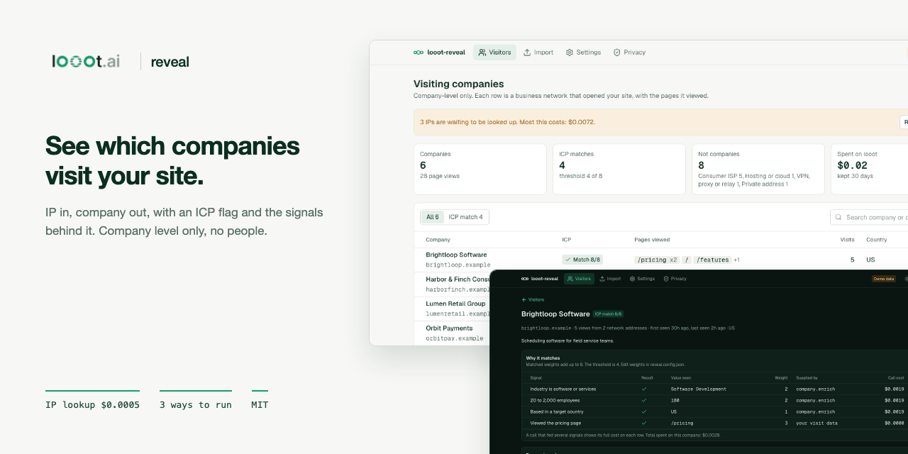
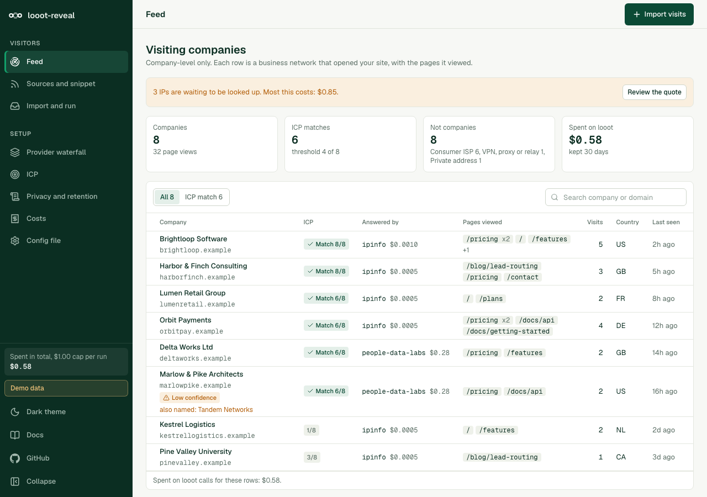
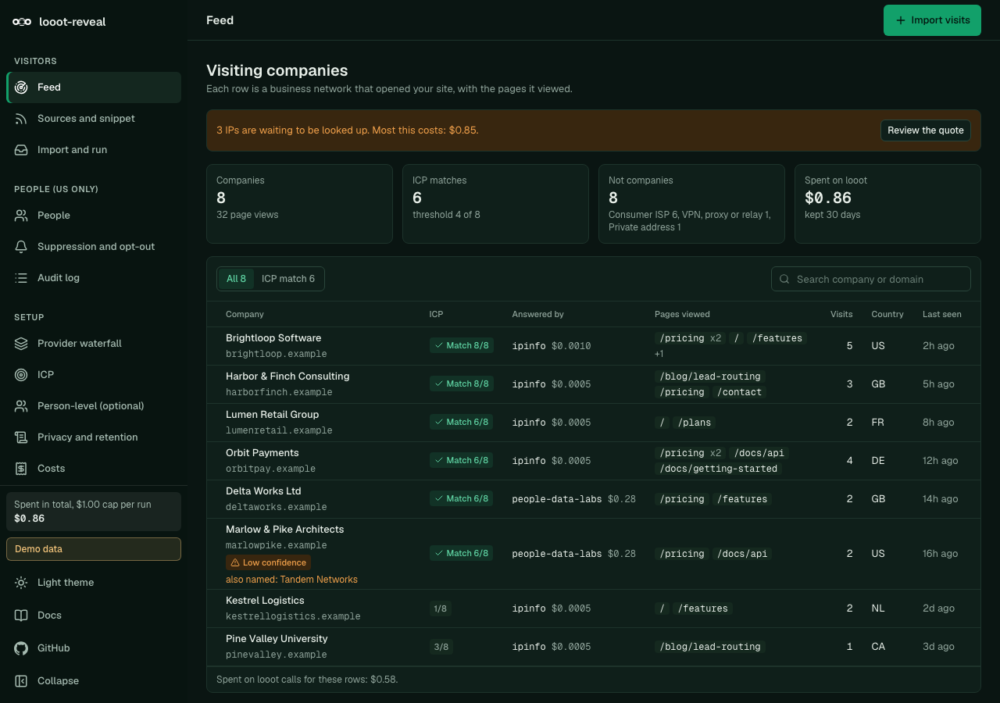

<p align="center"></p>

# looot-reveal

[](LICENSE) [](https://github.com/loootai/looot-reveal/releases) [](https://docs.looot.ai)

An open-source alternative to [RB2B](https://www.rb2b.com/pricing) and Clearbit Reveal: see which companies visit your website. RB2B starts at $0 for 150 identifications a month and $79 a month for 300 (public pricing page, read 2026-10-10). Clearbit Reveal now sells inside HubSpot Breeze Intelligence on a credit plan, with a third-party estimate of about $45 a month on top of a HubSpot seat (not a vendor figure, read 2026-10-10). This repo runs on one looot key and you pay list price per lookup, about $0.0005 to find the company behind an IP.

It reads an access log, a CSV of IPs, or visits from a small tracking snippet. It looks each IP up through looot's IP intelligence provider, drops ISPs, hosting and VPNs, enriches the company that is left, and shows a feed of visiting companies with the pages they viewed and an ICP match flag.




## Company level only

This app never tries to name a person behind a visit. An IP address is personal data under the GDPR and UK GDPR, and joining a visit to a named individual needs consent in most places and runs into state privacy laws in the US. Business network owners are public registry data. So the app stops at the company. See [Privacy and consent](#privacy-and-consent).

## What you need

- Node.js 20.9 or later to run the app and the CLI (Next.js 16 requires it). The tests need Node 22.12 or later (vitest 5). The repo has no `engines` field or `.nvmrc`; I ran everything on Node 24.18.
- Git and npm.
- For real lookups only, a looot account and token. Sign up at https://looot.ai/auth/sign-up. Then either run `npm i -g looot` and `looot login`, which opens a browser approval, or open the looot web app, go to Settings, "Agent tokens" and create one ([sign-in docs](https://docs.looot.ai/get-started/sign-in)). With no browser (CI), create the token in Settings > Agent tokens and `export LOOOT_TOKEN=...`.
- The token needs the scopes `runs.execute`, `catalog.read`, `runs.read` and `usage.read`.
- A funded balance. The minimum top-up is $5 and signing up adds no credit ([money docs](https://docs.looot.ai/money)).

No other account is used. There is no Supabase, no database and no LLM key. The IP lookup runs through looot.

## Try it in one minute

```bash
git clone https://github.com/loootai/looot-reveal && cd looot-reveal
npm ci
npm run demo
```

Open http://localhost:3520. The demo shows made-up companies on RFC 5737 addresses, needs no token, makes no looot call and costs nothing. Its data lives in memory and resets on restart. Stop it with Ctrl+C.

## Run it with your own data

Input is a combined-format access log, a CSV with an `ip` column (and optionally `path`, `timestamp`, `referrer`), JSON lines, or a bare list of IPs. `examples/access.log` and `examples/visits.csv` use RFC 5737 documentation addresses, so a real lookup on them finds nothing. Swap in your own file.

The web UI reads `.env.local`, the CLI does not. For the CLI, `export` the variables in your shell.

```bash
cp .env.example .env.local     # web UI only
```

| Variable | Needed | What it does | Where to get it |
| --- | --- | --- | --- |
| `LOOOT_TOKEN` | Required for real lookups | Your looot key. Not needed for the demo or `--dry-run`. | looot Settings > Agent tokens, or `looot login` |
| `LOOOT_API_URL` | Optional | Overrides the API base. Default `https://api.looot.ai`. | Leave unset |
| `REVEAL_DATA` | Optional | Web UI state file. Default `data/reveal.json`. | Any writable path |
| `REVEAL_CONFIG` | Optional | Web UI config file. Default `reveal.config.json`. | Copy `reveal.config.json` |
| `NEXT_PUBLIC_DEMO` | Optional | `1` runs the web UI on sample data. `npm run demo` sets it. | Leave unset for real data |

Quote first. A dry run needs no token and makes no network call, it also writes nothing. This is the real output:

```bash
npm run reveal -- --input examples/access.log --dry-run
```

```text
Read 5 page views (combined). Skipped: 1 assets, 1 bots, 0 error responses, 0 unreadable rows.
4 unique IPs: 1 private (skipped, free), 0 already answered (free), 3 to look up.
  IP lookup, one per new IP: 3 x $0.0005 = $0.0015  [ip.lookup, ipinfo--2]
  Company enrichment, at most one per new IP: 3 x $0.0019 = $0.0057  [company.enrich, job:company.enrich]
Most this run can cost: $0.0072. Spend cap: $1.00.
List prices dated 2026-10-10. The real charge is read from each run.
Dry run: no looot call was made and nothing was written.
```

Then the real run:

```bash
export LOOOT_TOKEN=...
npm run reveal -- --input access.log --cap 0.50
```

Results go to `reveal-out/visitors.json`, `visitors.csv` and `visitors.md` (change the folder with `--out`). Answers already bought are cached in `state/reveal.json` (change it with `--state`), so an IP seen again costs nothing. Run `npm run reveal -- --help` for all flags. Exit codes are 0 done, 1 run failed, 2 usage error or no token.

The web UI on a live key keeps its own state in `data/reveal.json` (`REVEAL_DATA`), not in the CLI's `state/reveal.json`. To see CLI results in the UI, set `REVEAL_DATA=state/reveal.json` or pass `--state data/reveal.json` to the CLI. Run it with `npm run build && npm start` (http://localhost:3000). Pages are Visitors (the feed), a company page with the signals behind its ICP flag, Import (paste or upload, see the quote, run), Settings (edit the config, delete data past retention, snippet) and Privacy. There is no sign-in and no Supabase, so run it behind your own access control.

## Spending

The quote prints before any call. The lookup count is exact. The enrichment count is a ceiling, because most addresses belong to consumer ISPs and are dropped before any company call.

| Step | looot job | Endpoint | List price |
|---|---|---|---|
| IP to owner, location, network type, VPN flags | `ip.lookup` | `ipinfo--2` | $0.0005 per new IP |
| Free variant, owner name and domain only | `ip.lookup` | `ipinfo-lite` | $0 |
| Company profile from the domain | `company.enrich` | job with provider fallback | from $0.0019 per new company |

Prices read from the public catalog on 2026-10-10. Example at list price: 100 new IPs cost $0.05 to look up. If 15 of them are business networks, enrichment adds at most $0.0285, so about $0.08 in total. The worst case, every IP enriched, is $0.24. Repeat IPs and repeat companies are free.

Money rules

- The quote shows before any paid action, and the UI button shows the amount it will spend.
- `--cap` (or `spendCapUsd` in the config) stops the run before a call that would pass it.
- Each call sends a stable idempotency key per input and job (`reveal:ip.lookup:<ip>`), so a retry never pays twice.
- A run still in progress when waiting stops is stored as pending. The next run collects it with the same key. It is never treated as failed at $0.
- The default cap is `spendCapUsd` in `reveal.config.json`, 1 dollar. `--cap` overrides it for one CLI run.
- A failed call is not charged.

## Deploy

I have not deployed this to Vercel. The steps below follow the code.

1. Push a copy of the repo to your own GitHub account.
2. In Vercel choose Add New > Project, import the repo. Next.js is detected, there is no `vercel.json`.
3. Add the environment variable `LOOOT_TOKEN`. Add `REVEAL_DATA` and `REVEAL_CONFIG` too (see below).
4. Deploy.

Things to know first.

- The app has no sign-in. Anyone who can open the URL can start a lookup run from Import or the Visitors page, up to the cap. Turn on Vercel Deployment Protection, or keep it on your own machine. The tracking snippet must reach `/api/collect` from your public site, so a protected deployment cannot collect visits from it.
- State and config are files. `REVEAL_DATA` (default `data/reveal.json`) and `reveal.config.json` are written by the app, and a serverless function may not be able to write them. Point `REVEAL_DATA` and `REVEAL_CONFIG` at writable paths. On Vercel that is `/tmp`, which does not persist between invocations, so collected visits would be lost. For a tracking snippet in production use a host with a persistent disk.
- `/api/collect` is open to any origin and has no rate limit. It stores a visit only when the body says the visitor consented. Collecting costs nothing. Looking up costs money and runs only when you click Run or run the CLI.

There is no scheduled workflow in this repo.

## Tracking snippet

```html
<script src="https://YOUR-HOST/reveal.js" defer></script>
<script>/* after the visitor accepts your banner */ window.revealGrant && window.revealGrant();</script>
```

Replace `YOUR-HOST` with the host where this app runs. The script posts to `/api/collect` on the host it was loaded from, or to the URL in a `data-endpoint` attribute. Consent can also be set by writing `granted` to `localStorage` key `reveal-consent`. It sends the page path and the referrer origin. The server reads the IP from `x-forwarded-for` and stores it only until it is resolved. Collecting costs nothing. Looking up costs money and happens only when you click Run or run the CLI.

## Signals behind the ICP flag

Every flag lists its signals. Weights and the threshold live in `reveal.config.json`.

| Signal | Value seen | Supplied by | Default weight |
|---|---|---|---|
| Industry matches a keyword list | company profile | `company.enrich` | 2 |
| Employee count in a range | company profile | `company.enrich` | 2 |
| Country in a list | company profile, else the IP lookup | `company.enrich` or `ip.lookup` | 1 |
| Viewed a page (for example `/pricing`) | your own visit data | not a looot call, $0 | 3 |

A company matches when matched weights reach the threshold (default 4 of 8). The company page shows each signal, whether it matched, the value seen, its weight, the provider that supplied it and the cost of that call. A call that fed several signals shows its full cost on each row. There is no hidden score.

## Privacy and consent

- An IP is personal data in the EU and UK. Use a consent banner before the snippet sends anything. The snippet waits for `window.revealGrant()`, and sends nothing when the browser signals Global Privacy Control or Do Not Track.
- After an IP has an answer, only a salted hash is stored (`storeRawIp: false`). The idempotency key, which contains the IP, is stored hashed too.
- Query strings are cut from paths before storage. They often hold emails and tokens.
- `retentionDays` (default 30) deletes visits and stored answers past the window on each CLI run and from Settings.
- Consumer ISP, mobile, hosting and VPN addresses are excluded from the feed.
- Name looot and IPinfo as processors in your privacy policy. This is not legal advice.

## Troubleshooting

Messages are quoted from the code.

| You see | What it means | What to do |
| --- | --- | --- |
| `LOOOT_TOKEN is not set. Create an agent token at https://looot.ai/settings, or use --dry-run.` | No token in the environment. Exit code 2. | `export LOOOT_TOKEN=...` in the same shell. The CLI does not read `.env.local`. In looot the token is under Settings > Agent tokens. |
| `LOOOT_TOKEN is not set on the server.` | The web UI has no token. | Put it in `.env.local` and restart, or add it in Vercel. |
| `Every call failed.` (exit 1), or visitors listed with reason `lookup_failed` | Every looot call failed. This is how a 401 (bad token or missing scope) or a 402 (balance too low) shows up here, because the run does not stop on them and does not print looot's message. | Check the token has the four scopes and the balance is funded (https://docs.looot.ai/money). Failed calls are not charged. Run again, answers already bought are kept. |
| `Stopped at the $X cap: N IPs and M domains were not run. Run again with a higher --cap.` | The cap was reached. | Raise `--cap` if you want the rest. |
| `N IPs are pending (still running or not run). Run the same command again to collect them. Pending runs are never charged twice.` | A call had not finished, or the cap stopped it. Not a failure. | Run the same command again. |
| Companies show "unknown" fields | The provider answer did not have the field, or the parser did not recognise its name. | See "How to file an issue". |
| `--input is required.` / `No file at <path>` / `Unknown --format <f>` / `--cap must be a number of dollars.` | Usage errors. Exit code 2. | Fix the flag. |
| `The config is not valid: ...` | `reveal.config.json` failed validation. Exit code 2. | Fix the field it names. |

How to file an issue. Open one at https://github.com/loootai/looot-reveal/issues with the command you used, the job (`ip.lookup` or `company.enrich`), the time of the call (from `calls` in the state file, which does not store looot run ids), and the raw response body with secrets removed. Do not paste real visitor IPs.

## Status

Dropped on purpose: person-level identification, email finding, and a hosted multi-user mode.

- No paid looot run was made. Parsing of the IPinfo and company answers is built from IPinfo's public field list and from fixtures, not from recorded paid responses. Which fields the `ipinfo--2` plan returns (company, ASN type, privacy flags) depends on the IPinfo tier behind looot. When only the ASN name is present, the app falls back to the `networkNameHints` list in the config to spot ISPs, and that list is a heuristic.
- The `company.enrich` job answer is read by looking for common field names. Providers differ, so a missing field shows as "unknown".
- The tracking snippet and collect route were not load tested and have no rate limit.

If a parser fails on a real response, open an issue with the raw body (see Troubleshooting).

## Install for agents

```bash
git clone https://github.com/loootai/looot-reveal && cd looot-reveal && npm ci
npm run reveal -- --input examples/access.log --dry-run
```

The Claude Code skill is in `skills/looot-reveal/SKILL.md` (copy it to `~/.claude/skills/`). `public/llms.txt` summarises the commands. The skill always dry-runs first and never raises the cap on its own.

## Develop

```bash
npm test && npm run typecheck && npm run lint && npm run build
npm run leak-scan
git config core.hooksPath .githooks
```

Stack: TypeScript, Next.js App Router, Tailwind. Built on [looot](https://looot.ai): one key and one prepaid balance for 2,500+ data endpoints, failed calls cost nothing.

## Licence

MIT, copyright looot.

## Related

Other open-source projects built on [looot](https://looot.ai):

- [looot-intent](https://github.com/loootai/looot-intent): account intent and buying-stage scoring (6sense)
- [looot-score](https://github.com/loootai/looot-score): lead and ICP fit scoring (MadKudu)
- [looot-techstack](https://github.com/loootai/looot-techstack): website technologies from several providers (BuiltWith, Wappalyzer)
- [looot-signals](https://github.com/loootai/looot-signals): hiring, funding and news triggers (TheirStack, Harmonic)
- [looot-lookalike](https://github.com/loootai/looot-lookalike): lookalike company search (Ocean.io)
- [looot-ads](https://github.com/loootai/looot-ads): competitor ad board (Foreplay)
- [looot-reviews](https://github.com/loootai/looot-reviews): review themes and weak spots (ReviewTrackers)
- [looot-battlecards](https://github.com/loootai/looot-battlecards): competitor battlecards (Klue, Crayon)
- [looot-mentions](https://github.com/loootai/looot-mentions): brand and keyword listening (Brand24)
- [looot-warm-leads](https://github.com/loootai/looot-warm-leads): warm leads from LinkedIn intent signals (Gojiberry)
- [looot-crm](https://github.com/loootai/looot-crm): a small CRM with buying signals built in
- [looot-seo](https://github.com/loootai/looot-seo): self-hosted SEO workspace
- [looot-monitor](https://github.com/loootai/looot-monitor): brand and competitor monitoring with alerts
